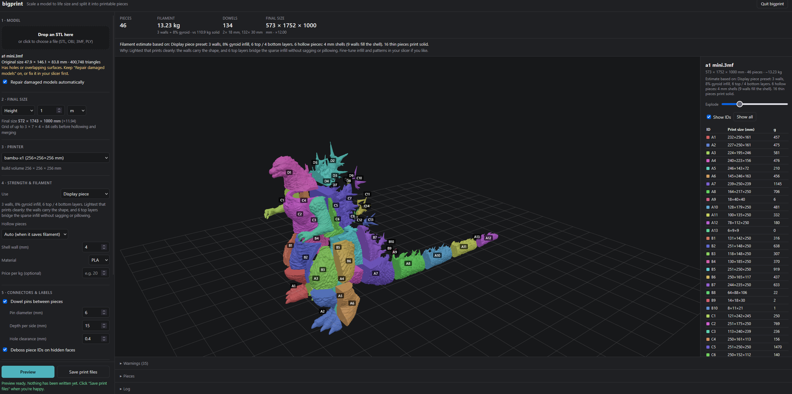

# bigprint: free model cutter for life-size 3D prints

[](#beta-status)
[](LICENSE)
[](https://ko-fi.com/pootertf)
[](https://buymeacoffee.com/pootertf)
[](https://github.com/sponsors/PooterTF)

A free, open-source model cutter built for **scaling models up to life size**.
Give it a model and a target size, such as 1.8 m tall. bigprint scales it up,
cuts it into pieces that fit your printer bed, hollows the pieces to save
filament, adds dowel-pin connectors, and labels every piece so you know how
they go back together.

**[Download for Windows](https://github.com/PooterTF/bigprint/releases/latest)**
(no Python needed) · [Install from source](#from-source-windows-macos-linux) ·
[Support the project](#support-bigprint)



### Beta status

bigprint is in **beta**. It works end to end and is tested automatically on
Windows, macOS and Linux, but it hasn't seen many real-world prints yet. Expect
rough edges, and please [report problems](https://github.com/PooterTF/bigprint/issues).
Before committing to a big print, print one joint (two neighbouring pieces and
a dowel) to check the fit with your printer and filament.

bigprint keeps your model's shape exactly, apart from these changes:

- **Changes it always makes:** the cuts themselves, plus dowel holes, piece
  labels and hollowing.
- **Changes it makes only when needed or asked:**
  - Damaged models (holes, overlapping surfaces) are rebuilt by automatic
    repair, which softens detail below the repair resolution shown in the log.
    Turn it off with `--no-repair`.
  - Smoothing (`--smooth`) is off unless you turn it on.
- **Housekeeping that doesn't change the shape:** STL files store every
  triangle's corners separately, so on loading, identical corner points are
  joined and zero-area or duplicate triangles are dropped. No point is moved.

```
bigprint statue.stl --height 1.8m --printer bambu-x1
```

```
Scaled x9.494 -> 1175 x 759 x 1500 mm
Cuts: x=-336.9,-86.2,164.6,336.9 y=-316.5,-65.8,184.8 z=250.0,500.0,750.0,1000.0,1250.0
Hollowing 66 cells (4 mm walls, 14.4 mm joint collars)
1 interior cell(s) fall entirely inside the hollow and need no printing
Merged 13 small fragment(s) into neighbours
62 pieces, 128 joints
293 dowels placed
62 pieces, ~24.33 kg filament -> statue_bigprint
```

## Support bigprint

bigprint is free and always will be. If it saved you time, filament or a
failed print, a tip helps keep it maintained and improving:

- ☕ **[Ko-fi](https://ko-fi.com/pootertf)**: one-off or monthly
- ☕ **[Buy Me a Coffee](https://buymeacoffee.com/pootertf)**: one-off or monthly
- 💖 **[GitHub Sponsors](https://github.com/sponsors/PooterTF)**: monthly or one-time, through your GitHub account

Not in a position to donate? Starring the repo, reporting bugs, and sharing
photos of your prints help a lot too.

## Install

### Windows: no Python needed

1. Download `bigprint-<version>-windows-x64.zip` and unzip it anywhere, for
   example `Documents\bigprint`. Keep the files together; the programs need the
   `_internal` folder next to them.
2. Double-click **`bigprint.exe`**. Your browser opens to the bigprint GUI.
3. When you're done, click **Quit bigprint** in the page.

The first time, Windows may say "Windows protected your PC" because the build
isn't signed by a known publisher yet. Click **More info → Run anyway**.

`bigprint-cli.exe` in the same folder is the command-line version. It takes the
same options as `bigprint` below (for example
`bigprint-cli.exe model.stl --height 1.8m --printer bambu-x1`).

### From source (Windows, macOS, Linux)

Requires Python 3.10+.

```
python -m venv .venv
.venv\Scripts\activate          # Windows  (source .venv/bin/activate on macOS/Linux)
pip install -e .
```

## Using the GUI

The GUI is the easiest way to use bigprint. Start it from the project folder
with the virtual environment activated:

```
bigprint-gui
```

Your browser opens to bigprint, which runs entirely on your computer: nothing is
uploaded to the internet, and only your own machine can connect to it. Keep the
terminal window open while you use it. To use a different port, run
`bigprint-gui --port 9000`.

When you're done, click **Quit bigprint** at the top right. This stops any
running preview, ends all background processes, removes temporary files, and
returns your terminal to its prompt. The tab then closes itself if the browser
allows it; otherwise it says it's safe to close. (Ctrl+C in the terminal also
works and cleans up the same way.)

1. **Model:** drag an STL onto the drop area, or click it to choose a file. The
   original size and triangle count are shown, with a note if the model has
   holes or overlapping surfaces. Leave **Repair damaged models
   automatically** on to have bigprint fix those.
2. **Final size:** choose Height, Width, Depth or Scale factor, and enter a
   value and unit. The final dimensions and grid size update as you type. If the
   model is low-poly enough that facets will show at that size, a note suggests
   turning on smoothing.
3. **Printer:** pick a preset, or "Custom…" to enter your build volume. Your
   choice is remembered next time.
4. **Strength & filament**, **Connectors & labels**, **Surface** and
   **Advanced:** the same options as the command line, with the same defaults.
5. **Save to:** the output folder, filled in as
   `Documents\bigprint\<model>_bigprint` by default.
6. Click **Preview**. This is a dry run: it does all the work and shows the
   result, but writes no files. You get progress and a Cancel button. Cancel
   stops the work immediately, even in the middle of a long step, so you can
   change settings and preview again straight away. When it finishes you see:
   - pieces, filament (vs printing solid), cost, dowel count and final size;
   - the 3D view with an explode slider (click a piece in its list to isolate it
     with its neighbours);
   - warnings, a piece table, and the full log.
7. Click **Save print files** to write everything to the output folder. This is
   quick, because it reuses the preview's results. If you change any setting
   after previewing, Save is disabled until you preview again, so the files
   always match what you saw. Then click **Open folder**.

Everything works offline, including the 3D view.

If you close the tab without clicking Quit, bigprint stops by itself after 10
minutes with no tab open (never while a preview or save is running). Starting it
again while it's already running just reopens the page. The Windows `.exe`
writes a log to `%LOCALAPPDATA%\bigprint\bigprint-gui.log`.

## Usage (command line)

The general form is:

```
bigprint <path to your STL> --height <target size> --printer <your printer> [options]
```

- **Source file.** Give the path to your STL (OBJ, 3MF and PLY also work). Put
  the path in quotes if it contains spaces.
- **Output folder.** By default, results go into a new folder next to the
  source file named `<model name>_bigprint`. For example, `C:\Models\deer.stl`
  writes to `C:\Models\deer_bigprint\`. Use `-o` / `--out` to choose a
  different folder.
- **Units.** Sizes take `mm` (the default if you give a bare number), `cm`,
  `m`, `in`, or `ft`.

The commands below are for PowerShell on Windows (the default terminal in VS
Code); lines starting with `#` are comments. Run them with the virtual
environment activated (`.venv\Scripts\activate`). On macOS/Linux, use `/` in
paths and `source .venv/bin/activate`.

### Choose the final size

Set exactly one of these. The model scales uniformly, so the other two
dimensions follow.

```
# Make the model 1.8 m tall (its Z height)
bigprint "C:\Models\knight.stl" --height 1.8m --printer bambu-x1

# Make it 6 feet tall
bigprint "C:\Models\knight.stl" --height 6ft --printer bambu-x1

# Make it 120 cm wide (its X size)
bigprint "C:\Models\dragon.stl" --width 120cm --printer prusa-mk4

# Make it 900 mm deep (its Y size); a bare number means mm
bigprint "C:\Models\car.stl" --depth 900 --printer prusa-mk4

# Scale it by a factor: 10x the original
bigprint "C:\Models\bust.stl" --scale 10 --printer bambu-x1
```

If the model is lying on its back after scaling, it was exported Y-up (common
from Blender and game assets). Add `--up y`, or `--up -y` if it ends up upside
down:

```
bigprint "C:\Models\helmet.stl" --height 35cm --up y --printer bambu-a1-mini
```

### Smooth out a low-poly model

Low-resolution models look faceted when scaled up a lot. For example, a 25 mm
model with ~0.5 mm triangles has ~35 mm flat facets at 1.8 m. `--smooth` fits
curved surfaces through the triangles after scaling:

```
# Smooth with the defaults: edges sharper than 60 deg stay crisp, ~5 mm triangles
bigprint "C:\Models\figure.stl" --height 1.8m --printer bambu-x1 --smooth

# Keep more edges crisp (anything sharper than 40 deg) and use a finer surface (3 mm)
bigprint "C:\Models\figure.stl" --height 1.8m --printer bambu-x1 --smooth --smooth-angle 40 --smooth-edge 3
```

- `--smooth-angle` (default 60): edges where faces meet more sharply than this
  stay sharp, such as a cap brim or shoe sole. Lower it if creases get rounded
  off; raise it if facets remain along curves.
- `--smooth-edge` (default 5 mm): the size of the new triangles. Smaller is
  smoother but slower and makes bigger files. On a 25 mm low-poly figure scaled to 1.8 m, `--smooth`
  roughly doubled the run time (79 s to 152 s).
- Smoothing removes facets but cannot add detail the model never had (texture,
  sharp small lettering). Fine features made of only a few triangles come out
  softer. Use a higher-resolution source model when you can.
- Occasionally, smoothing pushes two surfaces that were very close together
  (fingers, say) into contact. The run then warns which pieces are affected.
  Slicers repair these few edges on import, but check those pieces.

Run with `--dry-run` first and open `preview.html` to compare with and without
smoothing before generating every piece.

### Set your printer

Use a preset, or give the build volume as width x depth x height in mm:

```
# Preset
bigprint "C:\Models\knight.stl" --height 1.8m --printer ender3

# Custom build volume (here 300 x 300 x 400 mm)
bigprint "C:\Models\knight.stl" --height 1.8m --bed 300x300x400

# Keep pieces at least 10 mm smaller than the bed in every direction (default 5)
bigprint "C:\Models\knight.stl" --height 1.8m --bed 300x300x400 --margin 10
```

Presets: `bambu-x1`, `bambu-p1s`, `bambu-a1`, `bambu-a1-mini`, `bambu-h2d`,
`prusa-mk4`, `prusa-core-one`, `prusa-xl`, `prusa-mini`, `ender3`,
`ender3-v3`, `creality-k1`, `creality-k1-max`, `voron-350`. If you give
neither `--printer` nor `--bed`, it assumes 256 x 256 x 256 mm.

### Choose the output folder

```
bigprint "C:\Models\knight.stl" --height 1.8m --printer bambu-x1 -o "D:\Prints\Knight life size"
```

### Preview the split before generating files

`--dry-run` writes only `report.md` and `preview.html`. This lets you check
the piece count, sizes and filament estimate quickly before committing:

```
bigprint "C:\Models\knight.stl" --height 1.8m --printer bambu-x1 --dry-run
```

### Hollowing, strength and filament

```
# Hollow every piece that can be hollowed, with 5 mm walls
bigprint "C:\Models\statue.stl" --height 2m --printer bambu-x1 --hollow on --wall 5

# Never hollow; use solid geometry with slicer infill (heavier, stronger)
bigprint "C:\Models\statue.stl" --height 2m --printer bambu-x1 --hollow off

# Cosplay armour worn on the body: more walls and infill
bigprint "C:\Models\pauldron.stl" --width 30cm --printer prusa-mk4 --purpose wearable

# PETG at 22 per kg, to get a weight and cost estimate in the report
bigprint "C:\Models\statue.stl" --height 2m --printer bambu-x1 --material petg --price 22

# 0.6 mm nozzle (affects wall counts and estimates)
bigprint "C:\Models\statue.stl" --height 2m --printer bambu-x1 --nozzle 0.6
```

### Dowels

```
# 8 mm pins going 20 mm into each piece
bigprint "C:\Models\statue.stl" --height 2m --printer bambu-x1 --dowel-d 8 --dowel-depth 20

# Using metal or wooden dowels? Tighten or loosen the fit with --clearance
# (hole diameter minus pin diameter; default 0.4 mm)
bigprint "C:\Models\statue.stl" --height 2m --printer bambu-x1 --dowel-d 6 --clearance 0.25

# No dowels; glue only
bigprint "C:\Models\statue.stl" --height 2m --printer bambu-x1 --no-dowels
```

Before printing the whole model, print one joint (two neighbouring pieces and
a pin) to check the fit, and adjust `--clearance` if needed.

### Control where cuts go

```
# Space cuts evenly instead of moving them to narrow parts of the model
bigprint "C:\Models\statue.stl" --height 2m --printer bambu-x1 --even-cuts

# Place cuts yourself, in mm, in the scaled model's coordinates.
# Axes you don't list are still planned automatically.
bigprint "C:\Models\statue.stl" --height 2m --printer bambu-x1 --cuts "z=240,480,720 x=0"
```

Run once with `--dry-run` first. The report's "Cut planes" line shows where
the automatic cuts landed, which is a good starting point for manual ones.
Manual cuts aren't checked against the bed in advance: if a piece ends up too
big, the run prints a "does not fit the bed" warning.

### Turn features off

```
bigprint "C:\Models\statue.stl" --height 2m --printer bambu-x1 --no-labels --no-merge-small --no-preview
```

### A complete example

A 1.75 m figure for a Bambu Lab X1 in PLA, with 8 mm pins, a cost estimate,
and the results in a named folder:

```
bigprint "C:\Users\me\Downloads\knight.stl" `
  --height 1.75m `
  --printer bambu-x1 `
  --hollow auto --wall 4 `
  --dowel-d 8 --dowel-depth 18 `
  --material pla --price 20 `
  -o "C:\Users\me\Prints\knight_lifesize"
```

(The backtick `` ` `` at the end of a line continues the command in
PowerShell. Use `^` in Command Prompt and `\` on macOS/Linux.)

Run `bigprint --help` to see every option with its default.

## Output

| File | What it is |
|---|---|
| `pieces/A1.stl …` | One STL per piece, already oriented for printing |
| `project.3mf` | All pieces in one project. PrusaSlicer also picks up each piece's walls/infill settings |
| `dowels.stl` | All connector pins, laid flat for strength |
| `report.md` | Per-piece size, fill settings, filament estimate, neighbours, joints, warnings |
| `preview.html` | Interactive assembled/exploded 3D view; works offline, open it in any browser |

## How it works

1. **Load and repair.** Each shell is repaired separately, then all shells are
   unioned. This fixes the overlapping-parts layout common in downloaded models.
   Tiny broken fragments are dropped with a note. If the model has damage the
   shell-by-shell repair can't fix (holes next to overlapping or stitched
   surfaces, common in sculpts and scans), bigprint rebuilds a clean closed
   surface by voxelizing it at the final size. This softens detail below the
   repair resolution, shown in the log: about 1–4 mm depending on model size,
   with a warning when it's coarse. For the sharpest result on a badly damaged
   model, repair it in your slicer first (Bambu Studio / OrcaSlicer: right-click
   → Fix Model) and load the fixed STL.
2. **Scale** by `--height`, `--width`, `--depth`, or `--scale`. Units can be
   `mm`, `cm`, `m`, `in`, or `ft`. Use `--up y` for Y-up models. With
   `--smooth`, curved surfaces are then fitted through the triangles and
   subdivided, keeping sharp edges and flat faces as they are.
3. **Plan cuts.** It uses the fewest axis-aligned cuts that fit the bed. Then
   dynamic programming slides each cut to where the model's cross-section is
   smallest (necks, wrists, gaps). Seams end up small and less visible. Use
   `--even-cuts` to turn this off, or `--cuts "x=100 z=500,900"` to place cuts
   by hand.
4. **Hollow (FDM-safe).** The shell is measured from the original surface, so
   cavities stay **open at the cut faces** and no piece has a closed ceiling to
   bridge.
   - Next to each cut, the wall thickens into a straight **collar** that holds
     the dowels. It thins back to the normal wall at 45°, so no supports are
     needed.
   - Cells entirely inside the hollow are dropped.
   - With `--hollow auto`, a cell is hollowed only if that saves at least 20%
     over sparse infill. Thin parts stay solid.
5. **Merge fragments.** A tiny piece is fused into the neighbour it touches
   most, if the result still fits the bed.
6. **Dowels.** Holes go only where a full-depth hole stays inside material on
   **both** sides of the joint. This is checked by slicing each side at several
   depths. Bigger joints get more dowels, spread out across the face.
7. **Orientation.** Each piece is turned to whichever face-down orientation
   needs the least support. That is usually a flat cut face on the bed.
8. **Labels.** The ID (for example `C4`) is debossed on a mating face, so it is
   hidden after assembly. Faces that sit on the bed are avoided, and on curved
   collar rings the text follows the curve. The letter is the layer counting up
   from the bottom; the number orders pieces within that layer.
9. **Fill plan.** Each piece is marked `hollow`, `sparse`, or `solid`, with a
   gram estimate and a comparison to printing it solid.

## Options (most useful)

| Option | Default | |
|---|---|---|
| `--printer` / `--bed WxDxH` | 256³ | Presets: bambu-x1, bambu-a1-mini, prusa-mk4, prusa-core-one, prusa-xl, ender3, creality-k1(-max), voron-350, … |
| `--repair` / `--no-repair` | on | Rebuild damaged models automatically (otherwise stop with an explanation) |
| `--smooth` | off | Smooth the facets of low-poly models after scaling |
| `--smooth-angle`, `--smooth-edge` | 60°, 5 mm | Edges sharper than this stay crisp; size of the new triangles |
| `--hollow auto\|on\|off` | auto | Geometric hollowing |
| `--wall` | 4 mm | Hollow shell thickness |
| `--purpose display\|wearable\|structural` | display | Strength preset (see below) |
| `--dowel-d`, `--dowel-depth`, `--clearance` | 6, 15, 0.4 mm | Pin size, depth per side, hole clearance |
| `--no-dowels`, `--no-labels`, `--no-merge-small` | | Turn features off |
| `--material`, `--price` | pla | Weight and cost estimate |
| `--dry-run` | | Write only the report and preview |

## Strength presets

Each preset sets the slicer settings used for the filament estimate and
written into `project.3mf`. They're tuned for large parts with a 0.4 mm nozzle
and 0.2 mm layers. Use them as a sensible starting point; anything finer is
best adjusted in your slicer.

| Preset | Walls | Infill | Top / bottom layers | Why |
|---|---|---|---|---|
| Display piece (default) | 3 | 8% gyroid | 6 / 4 | Lightest that prints cleanly: the walls carry the shape, and 6 top layers bridge the sparse infill without sagging |
| Wearable / handled | 4 | 15% gyroid | 5 / 4 | Survives knocks and handling; the fourth wall adds most of the impact strength |
| Structural | 6 | 25% gyroid | 6 / 5 | Carries load: strength comes mostly from walls, so walls go up more than infill |

All three use gyroid, because pieces print in many different orientations and
gyroid is about equally strong in every direction. Hollow pieces get enough
walls to fill their shell (9 for a 4 mm shell); their thicker joint collars use
the preset's infill. Thin pieces that would be mostly walls anyway print solid.
The preview, report and command-line summary all state exactly which settings
the estimate assumes.

## Limitations / roadmap

- Cuts are axis-aligned planes. Angled or freeform cuts are not supported yet.
- Filament figures are planning estimates, not slicer-exact.
- Joints with tiny contact patches (where a cut grazes a surface) are glue-only,
  and the report lists them.
- The Windows build isn't code-signed yet, so Windows shows a warning on first run.
- No macOS or Linux standalone builds yet; use the from-source install there.

## Development

```
pip install -e .[dev]
pytest
```

### Building the Windows version

```
.venv\Scripts\python -m pip install pyinstaller
.\packaging\build_windows.ps1
```

This produces `dist\bigprint\` (`bigprint.exe` and `bigprint-cli.exe`) and
`dist\bigprint-<version>-windows-x64.zip`. The build bundles Python and all
libraries. It copies every bundled library's license into
`dist\bigprint\licenses\`, with a summary in `THIRD-PARTY-NOTICES.txt`.
Test it by unzipping the zip somewhere new and running it on a PC (or Windows
Sandbox) without Python installed.

three.js (MIT) is bundled in `bigprint/static/vendor/three/` and embedded into
each preview page, so previews work offline.

## Contributing

Bug reports, feature ideas and pull requests are welcome. See
[CONTRIBUTING.md](CONTRIBUTING.md).

## License

bigprint is free software: you can redistribute it and/or modify it under the
terms of the **GNU Affero General Public License v3.0 or later**
([LICENSE](LICENSE)).

In plain terms (the license text is what counts):

- You can use bigprint for anything, including commercial printing jobs. The
  license covers the software, not the models or prints you make with it.
- You can share, modify and even sell copies, as long as you pass on the same
  freedoms: include the license and make your source code (with your changes)
  available under AGPL-3.0.
- If you run a modified bigprint as a service that others use over a network,
  such as a website, you must offer those users your modified source too.

Third-party components keep their own licenses: see the `licenses` folder in
the Windows build, and `bigprint/static/vendor/three/LICENSE.txt` (three.js,
MIT).
